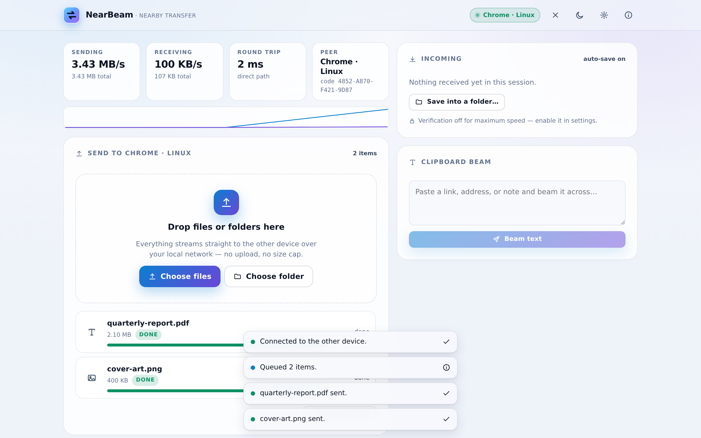
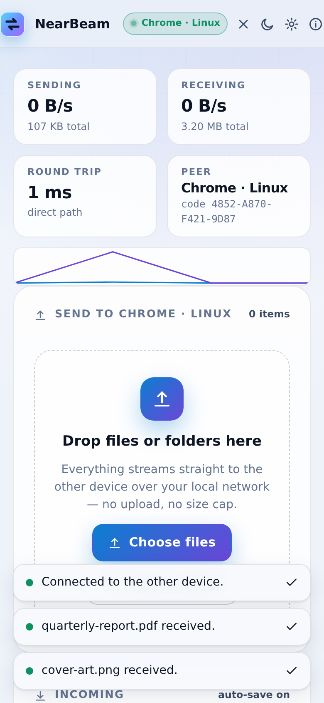
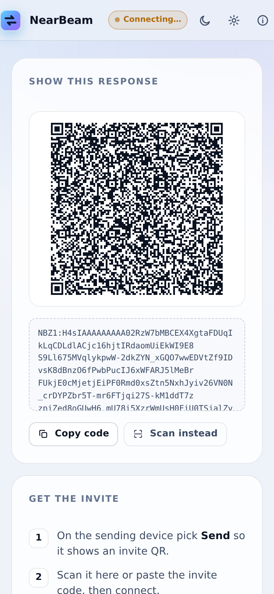

# NearBeam

**Direct, encrypted file & text transfer between nearby devices — at full LAN speed.**

NearBeam opens a peer-to-peer WebRTC data channel between two browsers and streams files,
folders and clipboard text straight from one device to the other. There is no upload, no
cloud storage, no account and no file-size cap: the website is only static files, and the
two devices do the rest themselves.

> Pairing needs no server either. One device shows a short invite code as a QR code (or a
> link you can drop into any chat app); the other device answers the same way. Those two
> codes are the entire "signalling server".

| Desktop workspace | Mobile workspace | Mobile pairing |
| :--: | :--: | :--: |
|  |  |  |

---

## Features

- **Peer-to-peer over your local network** — with the default settings only on-LAN
  candidates are used, so bytes never leave your Wi‑Fi/Ethernet segment.
- **Built for speed** — 64 KiB chunked streaming with SCTP backpressure, a one-chunk
  read-ahead pipeline, and an application-level brake so a slow disk never blows up memory.
- **Multi-gigabyte friendly** — incoming files stream straight to disk: into a folder you
  pick (Chromium desktop) or into the browser's sandboxed OPFS (everywhere else, including
  iOS Safari). Small files stay in RAM for zero-copy speed.
- **Files, folders and text** — drag & drop whole directories, pick folders from the file
  dialog, paste images from the clipboard, or beam a snippet of text.
- **Optional integrity verification** — streaming SHA-256 on both ends, computed while the
  bytes flow (no second read), verified on arrival.
- **Pair however you like** — QR scan (camera), QR on screen, copy/paste, or a shareable
  invite link. A matching "safety code" on both screens confirms you paired with the right
  device.
- **Installable & offline-capable PWA** — a build-time service worker precaches every asset,
  so an installed NearBeam keeps working on a LAN with no internet at all.
- **Responsive by design** — one codebase, tuned layouts for phones and desktops, dark and
  light themes, reduced-motion support.
- **Hardened hosting defaults** — strict CSP, permissions policy, immutable asset caching
  (see `vercel.json`).

## How pairing works

```
  Device A (sender)                        Device B (receiver)
  ─────────────────                        ───────────────────
  createOffer + ICE gather
        │  invite code (QR / link / paste)
        ├────────────────────────────────────────▶  setRemoteDescription
        │                                          createAnswer + ICE gather
        │        response code (QR / paste)
        ◀────────────────────────────────────────┤
  setRemoteDescription
        │
        └────────────  DTLS-encrypted data channel, direct  ────────────┐
                                                                       │
                    files / folders / text stream A ⇄ B  ◀─────────────┘
```

The codes are gzip-compressed, base64url-encoded SDP (~600 characters), which is small
enough for a scannable QR code and short enough to paste.

## Quick start (local)

```bash
npm install
npm run dev        # http://localhost:5173
```

Open it on two devices on the same network (or two tabs/windows on one machine to try it
out). One picks **Send**, the other **Receive**, scan or paste, and you're connected.

## Deploy to Vercel

The repo is deploy-ready — `vercel.json` pins the framework, build command and output
directory, and ships the security headers.

1. Push this folder to a GitHub repository.
2. In Vercel: **Add New → Project → Import** that repository.
3. Vercel auto-detects Vite (`build: npm run build`, output `dist`). Nothing else to set —
   there are no environment variables because there is no backend.
4. Deploy. Share the URL; both devices just open it.

Prefer the CLI?

```bash
npm i -g vercel
vercel link && vercel --prod
```

### Other hosts

Any static host works, because the app is 100% client-side:

- **Netlify** — build `npm run build`, publish `dist`, add a SPA rewrite to `/index.html`.
- **GitHub Pages** — set `base` in `vite.config.ts` to your repo path (e.g. `'/nearbeam/'`),
  build, and publish `dist`.
- **Your own box** — serve `dist/` with any web server over HTTPS (HTTPS is required for
  camera access and WebRTC on non-localhost origins).

## Browser support

Current Chrome, Edge, Firefox and Safari on desktop and mobile. Folder-pick and
stream-to-folder use the File System Access API where available (Chromium) and degrade
gracefully to sandboxed-disk or in-memory staging elsewhere.

## Performance notes

| Knob | Default | Why |
| --- | --- | --- |
| `CHUNK_SIZE` | 64 KiB | The well-tested sweet spot across engines; SCTP overhead is negligible at this size. |
| `HIGH_WATER` | 8 MiB | Send-buffer ceiling before we wait for `bufferedamountlow`. |
| `BRAKE_ON` / `BRAKE_OFF` | 32 / 8 MiB | Receiver asks the sender to pause when its unwritten queue grows (slow disk, phones). |
| `MEMORY_SINK_LIMIT` | 96 MiB | Above this, receives stage on disk instead of in RAM. |

All live in `src/lib/transfer.ts` and `src/lib/sinks.ts` if you want to tune them.

On a gigabit LAN with both devices wired or on 5 GHz Wi‑Fi, expect transfers limited by the
slowest link (disk or radio), not by NearBeam.

## Security & privacy model

- **Transport**: WebRTC data channels are DTLS/SRTP encrypted end to end. With the default
  empty ICE server list, candidates are host-only, so traffic stays on your LAN.
- **No backend**: nothing is uploaded, stored, or logged by a server. The deployed site is
  static files only.
- **Pairing authenticity**: both devices derive the same short "safety code" from the
  exchanged offer/answer pair; read it aloud to confirm you're paired with the intended
  device.
- **Filename hygiene**: received names are sanitised so a remote peer can't smuggle path
  separators into your downloads.
- **Hosting hardening**: strict Content-Security-Policy (no `unsafe-inline` scripts),
  `X-Frame-Options: DENY`, nosniff, referrer and permissions policies — see `vercel.json`.
- **Local-only state**: theme and settings live in `localStorage` on your device. Received
  OPFS staging files are purged on next launch.

## Project structure

```
src/
  lib/
    codec.ts      gzip+base64url invite-code encoding, URL/wrapped-code parsing
    rtc.ts        ICE config, gathering, stats, session safety code
    transfer.ts   the transfer engine (queue, chunking, backpressure, store)
    sinks.ts      where received bytes land (folder / OPFS / memory)
    sha256.ts     streaming SHA-256 (FIPS 180-4) for integrity checks
    format.ts     bytes/speed/duration formatting, filename sanitising
    pickFiles.ts  picker + drag&drop + folder-walk normalisation
    clipboard.ts  clipboard & Web Share helpers
    ua.ts         friendly device labels
  hooks/          usePeer (WebRTC lifecycle), useScanner, useSettings/useTheme, useToasts
  components/     UI: header, pairing, workspace, scanner, sheets, icons
  types/          ambient File System Access typings
scripts/
  make-icons.mjs  dependency-free PNG icon rasteriser (manifest icons)
  test-logic.mjs  unit tests: SHA-256 + codec vs Node reference impls
  e2e.mjs         two real headless Chromes pairing and transferring a file
```

## Scripts

```bash
npm run dev        # local dev server
npm run build      # typecheck + production build into dist/
npm run preview    # serve the production build
npm run lint       # oxlint
npm test           # logic unit tests (SHA-256, invite codec)
npm run icons      # regenerate PWA icons from the vector mark
npm run test:e2e   # full browser-to-browser transfer test (3 MiB, memory sink)
npm run test:large # 120 MiB transfer exercising the OPFS disk sink
```

`test:e2e` needs a one-time local install of Puppeteer (it is intentionally **not** a
project dependency, so deploys stay fast):

```bash
npm i -D puppeteer
npm run test:e2e
```

The suite launches two isolated headless Chrome instances, pairs them through the real UI,
pushes a 3 MiB file, and asserts the downloaded bytes are SHA-256 identical to the source —
all while serving `dist/` with the same CSP headers production uses. `test:large` repeats the
dance with a 120 MiB payload so the on-disk (OPFS) receive path and auto-save are covered too.

## License

MIT — see [LICENSE](./LICENSE).
